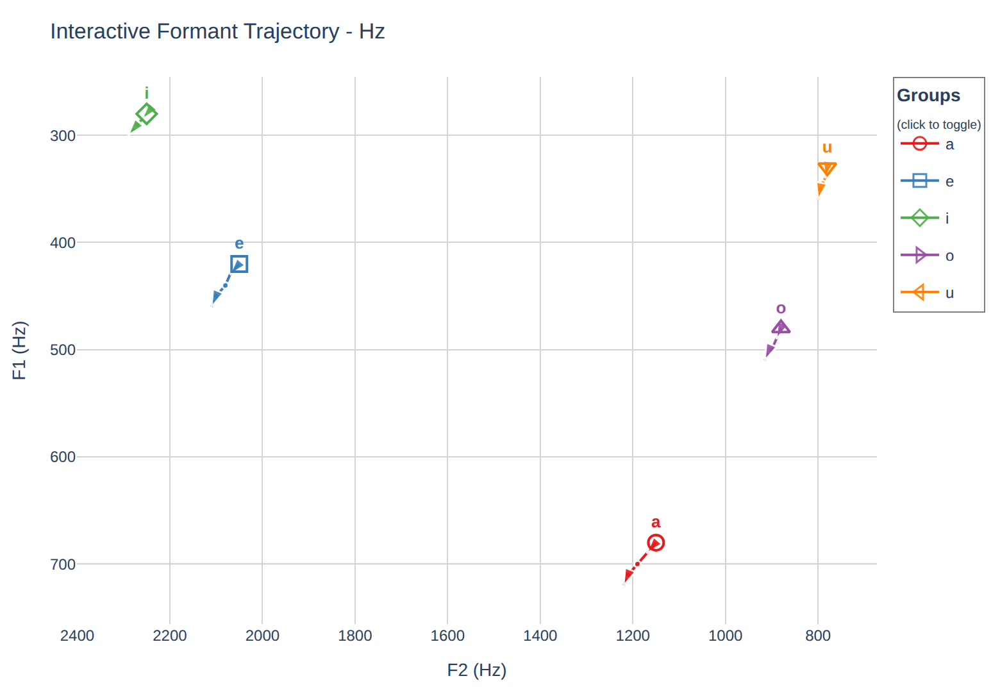
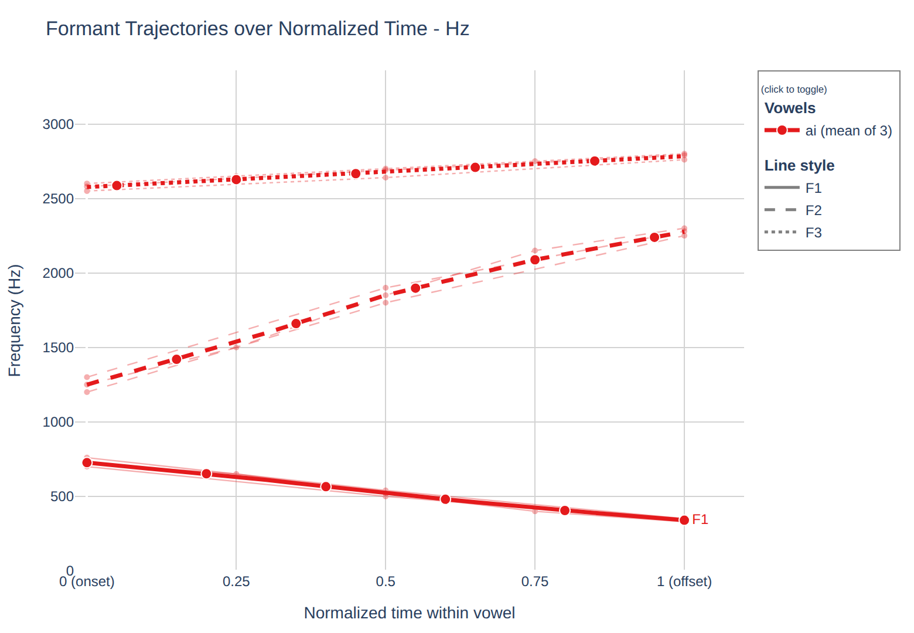
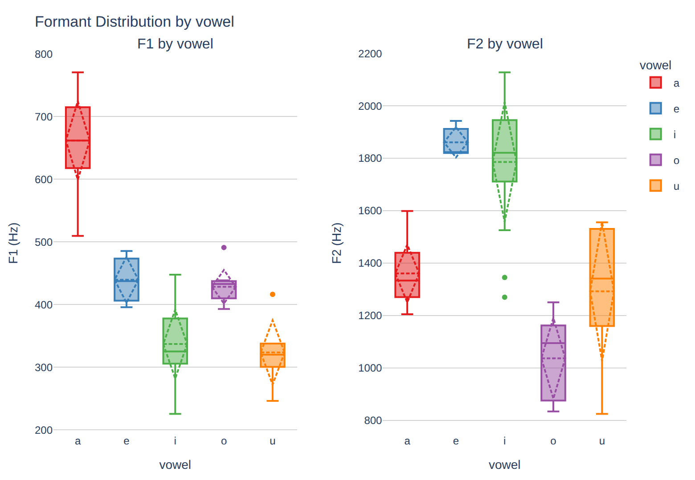
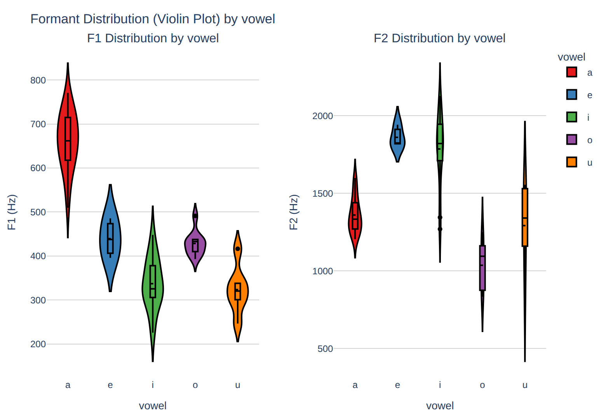
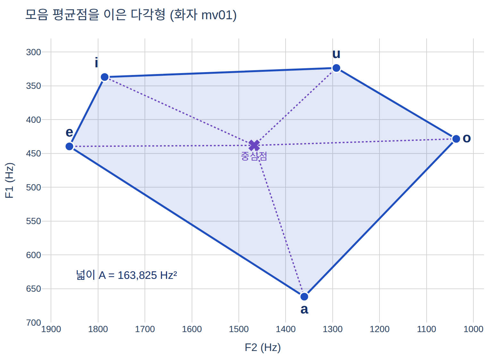

<!--
title: Vowel Space Visualizer
footer: Vowel Space Visualizer · vowelspace.tyoon.net
logo: img/logo.png
output: vowelspace.html
-->

<!-- layout: title -->
# Vowel Space Visualizer
## 음성 파일에서 모음 공간 그래프까지, 브라우저 하나로
2026년 11월 · https://vowelspace.tyoon.net

::: presenter
**발표 · 윤태진**

성신여자대학교 창의융합대학장 · 영어영문학과 교수

홈페이지 [https://tyoon.net](https://tyoon.net)
:::

::: notes
Vowel Space Visualizer는 모음의 포먼트를 측정하고 모음 공간 그래프로 그려 주는 웹 도구입니다. 오늘은 모음 공간이 무엇인지 짧게 짚고, 사용 순서, 네 가지 그래프, 포먼트 추출 방법, 통계 분석 순서로 소개합니다.
:::

---
# 오늘의 순서

::: cards
### 1 · 모음 공간
F1·F2로 모음을 그리는 이유와 이 도구가 하는 일

### 2 · 사용하기
로그인, 입력 자료, 올린 파일의 보관과 삭제

### 3 · 네 가지 그래프
정적 모음 공간, 타원, 두 가지 포먼트 궤적

### 4 · 주파수 척도
Hz와 청각 척도 Bark, ERB, Mel

### 5 · 포먼트 추출
추출 네 단계와 포먼트 ceiling

### 6 · 통계 분석
기술통계, MANOVA, 쌍별 검정, PCA, LDA
:::

---
<!-- layout: section -->
# 1 · 모음 공간
## 포먼트 두 개로 모음을 그립니다

---
<!-- layout: split | image: img/ellipse_hz.png | caption: 남성 화자 1명의 모음 a, e, i, o, u (테스트 음성에서 추출) -->
# 모음 공간은 F1과 F2의 지도입니다

- **포먼트**는 성도(聲道)의 공명 주파수입니다
- **F1**은 혀의 높이: 고모음일수록 낮습니다
- **F2**는 혀의 앞뒤: 전설 모음일수록 높습니다
- 두 축을 **뒤집어** 그리면 입안의 혀 위치와 닮은 그림이 됩니다

::: note
위쪽이 고모음, 왼쪽이 전설 모음입니다. /i/는 왼쪽 위, /a/는 아래에 놓입니다.
:::

::: notes
그림은 이 도구에 들어 있는 테스트 음성에서 실제로 추출한 값입니다. 축 방향이 일반 그래프와 반대라는 점을 먼저 설명합니다.
:::

---
# 녹음에서 그래프까지 한 번에 처리합니다

::: flow
- 🔐 로그인
- 📤 파일 올리기
- 🎚️ 포먼트 추출
- 📊 그래프
- 📈 통계·CSV
:::

- Praat 스크립트 없이 **WAV + TextGrid**만 올리면 됩니다
- 이미 측정한 값(**CSV·XLSX**)도 그대로 그릴 수 있습니다
- 그래프는 **확대·숨기기·PNG 저장**이 됩니다
- 설치할 것이 없습니다: 웹 브라우저로 접속합니다

::: notes
측정은 서버에서 Praat 엔진(Parselmouth)으로 수행하고, 그래프는 Plotly로 그립니다.
:::

---
<!-- layout: section -->
# 2 · 사용하기
## 로그인하고, 올리고, 그립니다

---
<!-- layout: split | image: img/ui_login.png | caption: 로그인 화면 (vowelspace.tyoon.net/login) -->
# 계정을 만들고 로그인합니다

1. **Sign up**에서 사용자 이름, 이메일, 비밀번호(8자 이상)를 입력합니다
2. 로그인할 때 간단한 **덧셈 문제**에 답합니다
3. 끝나면 오른쪽 위 **Log out**을 누릅니다

- 모든 화면과 기능은 로그인한 뒤에만 열립니다
- 올린 파일은 **계정마다 따로** 보관됩니다

---
<!-- layout: split | image: img/ui_main.png | caption: 로그인 후 첫 화면 -->
# 설정을 고르고 파일을 올립니다

- **Visualization Type**: 그래프 종류 4가지
- **Formant Scale**: Hz, Bark, ERB, Mel
- **Formant Ceiling**: 음성 파일을 올릴 때만 쓰입니다
- **Choose Files** 뒤 **Visualize**

::: note
기본값 그대로 두고 파일만 올려도 그래프가 나옵니다.
:::

---
# 입력 자료는 두 가지입니다

::: cols
### 측정값 표
- **CSV · TXT · XLSX**
- 필요한 열: `vowel`, `F1`, `F2`
- 선택 열: `speaker`, `native_language`, `time`, `F3`
- 열 이름이 달라도 **자동으로 인식**합니다
+++
### 음성 파일
- **WAV + TextGrid** (이름이 같은 짝)
- 예: `fv01_kor_s01.wav` ↔ `fv01_kor_s01.TextGrid`
- 파일 이름 첫 부분이 **화자**, 둘째 부분이 **언어·그룹**입니다
- TextGrid에 모음 레이블이 든 구간 tier가 있어야 합니다
:::

::: notes
모음 레이블은 ARPABET, IPA, 로마자 표기를 모두 인식합니다. 단어 tier는 모음 tier로 쓰지 않습니다.
:::

---
# 한 번 올리면 설정만 바꿔 다시 그립니다

- 올린 파일은 **Delete uploaded files**를 누를 때까지 남습니다
- 그래프 종류나 척도를 바꾸고 **Visualize**만 다시 누릅니다
- 같은 추출 설정이면 저장된 측정값을 써서 **바로** 그립니다
- 새 파일을 올리면 이전 파일을 대신합니다
- **7일** 동안 쓰지 않은 파일은 자동으로 지워집니다

::: note
녹음 파일은 다른 사용자가 볼 수 없습니다. 작업이 끝나면 삭제 단추를 눌러 주세요.
:::

---
<!-- layout: section -->
# 3 · 네 가지 그래프
## 같은 자료를 네 가지 방법으로 봅니다

---
<!-- layout: image | image: img/static_hz.png | caption: 정적 모음 공간: 화자 2명, 모음 12종, 토큰 106개 (테스트 음성 5개에서 추출) -->
# 모음은 색과 모양으로 함께 구분합니다

::: notes
모음마다 색과 표식 모양이 정해져 있어, 모음 수가 많아 색이 비슷해져도 모양으로 구분됩니다. 화자는 표식의 채움으로 구분합니다. 여기서는 채운 표식이 여성 화자, 빈 표식이 남성 화자입니다. 범례를 누르면 그 모음을 숨기고, 두 번 누르면 그 모음만 남깁니다.
:::

---
<!-- layout: split | image: img/ellipse_hz.png | caption: 타원 모음 공간 (Vowel Space with Ellipses) | wide: 1 -->
# 타원은 모음의 범위를 보여 줍니다

- 타원 하나가 한 모음의 **95% 신뢰 영역**입니다
- 타원 중심에 **모음 기호**가 붙습니다
- 타원이 **겹치면** 두 모음이 음향적으로 가깝다는 뜻입니다
- 타원이 **크면** 발화마다 차이가 크다는 뜻입니다

::: notes
이 화자에서는 /u/의 타원이 F2 방향으로 길게 퍼져 /i/, /o/와 겹칩니다. 화자나 언어 집단이 여럿이면 선 모양(실선, 파선, 점선)으로 구분합니다.
:::

---
# 궤적 그래프는 모음 안의 움직임을 보여 줍니다

::: cols
### F1–F2 평면의 궤적

- 빈 표식이 **시작**, 화살촉이 **끝**입니다
+++
### 정규화 시간의 궤적

- 시간을 **0–1**로 맞춰 겹쳐 봅니다
- 굵은 선이 **평균**입니다
:::

::: notes
두 그림 모두 설명용 예제 자료입니다. 궤적 그래프에는 한 발화 안에서 여러 시점을 측정한 표가 필요합니다. 음성 파일에서 추출한 값은 모음당 한 점이므로 궤적 그래프에는 맞지 않습니다. 오른쪽 그림은 이중모음 /ai/로, F1이 내려가고 F2가 올라갑니다.
:::

---
<!-- layout: section -->
# 4 · 주파수 척도
## 귀는 Hz대로 듣지 않습니다

---
<!-- layout: split | image: img/scales.png | caption: 세 청각 척도는 낮은 주파수에서 가파르고 높은 주파수에서 완만합니다 | wide: 1 -->
# 같은 100 Hz라도 다르게 들립니다

- **Hz**는 1초에 진동하는 횟수, 곧 **물리적** 단위입니다
- 귀는 **낮은 주파수**의 차이에 더 민감합니다
- 300 → 400 Hz는 **0.99 Bark** 차이입니다
- 2300 → 2400 Hz는 **0.28 Bark** 차이입니다

::: note
청각 척도는 "귀에 들리는 거리"가 같아지도록 주파수 축을 다시 그린 것입니다.
:::

::: notes
Hz로 그린 모음 공간에서는 F2 방향의 거리가 실제로 들리는 것보다 크게 보입니다. F1은 수백 Hz, F2는 1000~2500 Hz 범위이기 때문입니다. 청각 척도로 바꾸면 F1의 차이가 상대적으로 커지고 F2의 차이는 줄어듭니다. 그림은 0~4000 Hz 범위를 100%로 놓고 각 척도에서의 위치를 그린 것입니다.
:::

---
<!-- footnote: 이 도구가 쓰는 공식: Traunmüller (1990), Glasberg & Moore (1990), O'Shaughnessy (1987). $f$는 Hz 단위 주파수 -->
# 청각 척도는 세 가지를 지원합니다

| 척도 | 무엇을 기준으로 만들었나 | 공식 |
|---|---|---|
| **Bark** | **임계 대역**: 귀가 한 덩어리로 듣는 주파수 폭 | $z = \dfrac{26.81\,f}{1960 + f} - 0.53$ |
| **ERB** | **청각 필터의 폭**: 임계 대역을 더 정밀하게 잰 값 | $E = 21.4\,\log_{10}(1 + 0.00437\,f)$ |
| **Mel** | **음높이 지각**: "두 배 높게 들린다"는 판단 | $m = 2595\,\log_{10}\!\left(1 + \dfrac{f}{700}\right)$ |

- 세 척도 모두 낮은 주파수는 **넓게**, 높은 주파수는 **좁게** 폅니다
- 서로 단위가 다를 뿐, 곡선의 모양은 비슷합니다

::: notes
임계 대역은 달팽이관의 기저막에서 한 번에 함께 반응하는 주파수 범위입니다. 1 Bark가 임계 대역 하나에 해당합니다. ERB는 같은 생각을 더 정밀한 실험으로 다시 잰 것이고, Mel은 청자에게 음높이를 판단하게 한 실험에서 나왔습니다. Mel은 1000 Hz가 1000 Mel이 되도록 맞춰져 있습니다.
:::

---
# 같은 주파수가 척도마다 이렇게 바뀝니다

| Hz | Bark | ERB | Mel |
|---|---|---|---|
| 500 | 4.92 | 10.77 | 607 |
| 1000 | 8.53 | 15.62 | 1000 |
| 2000 | 13.01 | 21.16 | 1521 |
| 3000 | 15.69 | 24.60 | 1876 |

- 500 → 1000 Hz는 **3.6 Bark**, 2000 → 3000 Hz는 **2.7 Bark**입니다
- 주파수 차이는 두 배인데 청각 거리는 오히려 **작습니다**

::: notes
표의 값은 이 도구의 변환 함수로 계산한 것입니다. 학생들에게 500과 1000 사이, 2000과 3000 사이의 Bark 차이를 직접 빼 보게 하면 좋습니다. 8.53 빼기 4.92는 3.61이고 15.69 빼기 13.01은 2.68입니다.
:::

---
<!-- layout: split | image: img/ellipse_bark.png | caption: 같은 자료를 Bark 척도로 그린 타원 모음 공간 | wide: 1 -->
# 척도는 목적에 맞게 고릅니다

- **Hz**: 측정값을 그대로 보고할 때
- **Bark · ERB**: 모음 사이의 **지각 거리**를 비교할 때
- **Mel**: 음성 공학 자료와 맞출 때
- 척도를 바꾸면 **그래프와 통계**에 함께 적용됩니다

::: note
내려받는 CSV의 값은 척도와 관계없이 항상 Hz입니다.
:::

::: notes
앞의 Hz 그림과 비교해 보면 F1 방향(세로)이 상대적으로 넓어지고 F2 방향(가로)이 좁아집니다. Mel은 음성 인식에서 쓰는 MFCC의 기반 척도입니다.
:::

---
<!-- layout: section -->
# 5 · 포먼트 추출
## 화자에 맞춰 측정합니다

---
<!-- footnote: 측정: Praat To Formant (burg), 포먼트 5개, 25 ms 창, 10 ms 간격. Boersma & Weenink, [Praat manual](https://www.fon.hum.uva.nl/praat/manual/Sound__To_Formant__burg____.html) -->
# 포먼트는 네 단계로 추출합니다

::: flow
- 🔎 모음 구간 찾기
- 🎚️ ceiling 정하기
- 📏 토큰 측정
- 🧹 정리·내보내기
:::

- 음성을 **16 kHz**로 맞추고 TextGrid에서 모음 구간만 고릅니다
- 화자마다 가장 안정적인 **포먼트 ceiling**을 찾습니다
- 모음 **가운데 25%** 구간에서 5개 지점을 재어 평균합니다
- 모음별 **±3 표준편차** 밖의 값은 빼고 CSV로 내려받습니다

::: notes
모음의 양 끝은 앞뒤 자음의 영향을 받으므로 가운데 구간만 씁니다. 다섯 지점을 평균하면 한 프레임에서 값이 튀는 문제가 줄어듭니다.
:::

---
<!-- footnote: 관례값: Boersma & Weenink, [Praat manual](https://www.fon.hum.uva.nl/praat/manual/Sound__To_Formant__burg____.html) -->
# 포먼트 ceiling은 포먼트를 찾을 상한선입니다

- Praat은 **0 Hz부터 ceiling까지**에서 포먼트 **5개**를 찾습니다
- 성도가 **짧을수록** 포먼트가 높아 ceiling도 높아야 합니다
- 관례는 **남성 5000 Hz**, **여성 5500 Hz**입니다
- 그러나 같은 성별 안에서도 화자마다 성도 길이가 다릅니다

::: note
ceiling은 "이 화자의 다섯째 포먼트가 어디쯤 있는가"에 대한 가정입니다.
:::

::: notes
포먼트 분석(LPC)은 정해진 주파수 범위 안에 정해진 개수의 공명이 있다고 가정하고 그 위치를 찾습니다. 그래서 범위가 화자와 맞지 않으면 결과가 틀어집니다. Praat에서는 Maximum formant라는 이름의 설정입니다. 어린이처럼 성도가 짧은 화자는 훨씬 높은 값이 필요합니다.
:::

---
<!-- footnote: 화자 mv01(남성)의 모음 평균. 같은 녹음을 ceiling만 바꿔 이 도구로 다시 측정한 실제 결과 -->
# ceiling이 틀리면 측정값이 달라집니다

| ceiling | /i/ F1 | /i/ F2 | /a/ F1 | /a/ F2 |
|---|---|---|---|---|
| 4000 Hz (너무 낮음) | 317 | **1546** | 649 | 1292 |
| **5060 Hz (자동 선택)** | 337 | 1786 | 662 | 1360 |
| 6500 Hz (너무 높음) | **1241** | **2446** | **1041** | 1951 |

- **너무 낮으면** 포먼트 두 개가 하나로 **합쳐집니다**: /i/의 F2가 240 Hz 낮아졌습니다
- **너무 높으면** 포먼트 하나가 둘로 **쪼개집니다**: /i/의 F1이 1241 Hz가 되었습니다

::: notes
같은 녹음, 같은 모음인데 설정 하나로 값이 이만큼 달라진다는 점을 강조합니다. /i/의 F1이 1241 Hz라는 것은 고모음에서는 있을 수 없는 값입니다. 높은 ceiling에서는 가짜 포먼트가 끼어들어 번호가 밀리거나, 토큰마다 결과가 크게 흔들립니다. 단위는 모두 Hz입니다.
:::

---
<!-- layout: split | image: img/sweep.png | caption: 화자 mv01: 4000–4300 Hz는 불가능한 결과로 기각, 5060 Hz에서 점수가 가장 낮음 | wide: 1 | footnote: 기준: Feinberg (2019) [OSF PDWCB](https://doi.org/10.17605/OSF.IO/PDWCB) · 기각 규칙: Barreda (2021) Fast Track -->
# 가장 안정적인 ceiling을 찾습니다

1. **4000–8000 Hz**를 100 Hz 간격으로 모두 시도합니다
2. 설정마다 모든 모음의 F1–F4를 잽니다
3. **F3·F4가 얼마나 흔들리는지** 점수를 매깁니다
4. 불가능한 결과는 **기각**합니다
5. 가장 좋은 곳 주변을 **20 Hz** 간격으로 다시 찾습니다

::: notes
F3와 F4는 모음이 달라져도 크게 변하지 않습니다. 그래서 ceiling이 맞으면 모든 토큰에서 F3, F4가 거의 일정해야 하고, 틀리면 토큰마다 흔들립니다. 그 흔들림(분산)이 점수입니다. 기각 규칙은 F1 중앙값이 1200 Hz를 넘거나 F1과 F2가 붙어 버린 토큰이 많은 경우 등입니다. 그림에서 6000 Hz 부근의 큰 봉우리가 앞 장 표의 "너무 높음"에 해당합니다.
:::

---
<!-- footnote: 테스트 음성 5개의 실제 결과 · Escudero, Boersma, Rauber & Bion (2009) JASA 126(3) -->
# 결과는 화자별로 보고됩니다

| 화자 | 토큰 수 | 선택된 ceiling |
|---|---|---|
| mv01 (남성, 파일 4개) | 97 | **5060 Hz** |
| fv01 (여성, 파일 1개) | 9 | **6940 Hz** |

- 파일 이름의 첫 부분이 같으면 **같은 화자**로 묶습니다
- 기준을 **모음 내 F1–F2 안정성**으로 바꿀 수 있습니다
- 모음마다 ceiling을 따로 찾을 수도 있습니다(토큰 5개 이상)
- 고정값 **5500 · 5000 · 직접 입력**도 고를 수 있습니다

::: note
토큰이 적으면 결과가 불안정합니다. 여성 화자의 값은 토큰 9개에서 나온 것입니다.
:::

::: notes
자동 방식은 성별을 추정하지 않고 화자의 자료로 직접 찾습니다. 여성 화자의 6940 Hz는 토큰이 9개뿐이어서 나온 값이므로 그대로 믿기 어렵습니다. 화자당 모음 토큰을 넉넉히 준비해야 한다는 점을 말합니다. Escudero 등은 같은 화자라도 모음에 따라 알맞은 ceiling이 다르다고 보고했습니다.
:::

---
<!-- layout: section -->
# 6 · 통계 분석
## 눈으로 본 차이를 숫자로 확인합니다

---
# 통계 분석은 여섯 가지 질문에 답합니다

::: cards
### 기술통계
각 모음의 값은 얼마이고 얼마나 퍼져 있는가

### 다변량 분산분석 (MANOVA)
모음에 따라 포먼트가 정말 다른가

### 쌍별 검정
어느 두 모음이 얼마나 다른가

### PCA
자료가 가장 크게 변하는 방향은 어디인가

### LDA
포먼트만으로 모음을 맞힐 수 있는가

### 모음 공간 크기
모음 공간이 얼마나 넓은가
:::

::: note
아래 예시는 모두 남성 화자 mv01의 모음 a, e, i, o, u 토큰 65개로 계산한 실제 결과입니다.
:::

::: notes
그래프를 그린 뒤 통계 분석 단추를 누르면 같은 자료로 분석합니다. 고른 척도(Bark 등)가 통계에도 적용됩니다. 예시 자료는 모음마다 토큰 수가 다르고, 특히 /e/는 3개뿐이라는 점을 미리 말해 둡니다.
:::

---
# 기술통계: 평균과 표준편차로 요약합니다

| 모음 | 토큰 수 | F1 평균 (표준편차) | F2 평균 (표준편차) |
|---|---|---|---|
| a | 31 | 662 (64) | 1360 (112) |
| e | 3 | 440 (45) | 1861 (71) |
| i | 16 | 337 (57) | 1786 (236) |
| o | 9 | 428 (28) | 1037 (164) |
| u | 6 | 324 (56) | 1292 (291) |

- **평균**은 그 모음의 대표 위치, **표준편차**는 퍼진 정도입니다
- /u/의 F2 표준편차가 가장 큽니다: 타원이 가로로 길었던 이유입니다

::: notes
단위는 Hz입니다. 이 표의 평균이 타원 그림의 중심점이고, 표준편차가 타원의 크기를 정합니다. 최소값과 최대값도 함께 나옵니다. 토큰 수가 적은 모음의 평균은 믿을 만한 정도가 낮다는 점도 짚습니다.
:::

---
# 분포는 박스플롯과 바이올린 플롯으로 봅니다

::: cols
### 박스플롯

- 상자는 **가운데 50%**, 가운데 선은 **중앙값**
- 따로 떨어진 점은 **이상치**입니다
+++
### 바이올린 플롯

- 폭이 넓은 곳에 값이 **많이** 모여 있습니다
- 봉우리가 둘이면 집단이 섞였을 수 있습니다
:::

::: notes
박스플롯의 수염은 상자 길이의 1.5배 안에 있는 가장 먼 값까지입니다. 바이올린 플롯은 박스플롯에 분포의 모양을 더한 그림입니다. 밀도 플롯도 같은 정보를 곡선으로 보여 줍니다.
:::

---
<!-- layout: split | image: img/meancmp.png | caption: 평균 비교 플롯: 막대 위 n은 토큰 수 | wide: 1 -->
# 오차 막대는 평균의 불확실성입니다

- 막대 높이는 **평균**입니다
- 오차 막대는 **표준오차**입니다
- 토큰이 **많을수록** 오차 막대가 짧아집니다

::: math
\mathrm{SE} = \frac{s}{\sqrt{n}}
:::

- $s$는 표준편차, $n$은 토큰 수입니다

::: note
표준편차는 자료가 퍼진 정도, 표준오차는 평균을 얼마나 믿을 수 있는지입니다.
:::

::: notes
학생들이 표준편차와 표준오차를 자주 혼동합니다. /a/는 토큰이 31개라 오차 막대가 짧고, /u/는 6개라 깁니다.
:::

---
# 다변량 분산분석(MANOVA): 모음에 따라 정말 다른가
## Multivariate Analysis of Variance

- **질문**: F1과 F2를 **함께** 볼 때 모음들의 평균이 다른가
- **Wilks' Λ = 0.039**: 0에 가까울수록 모음이 잘 나뉩니다(1이면 차이 없음)
- 이어서 포먼트 **하나씩** 분산분석(ANOVA)으로 확인합니다

| 포먼트 | F 값 | p 값 | 판정 |
|---|---|---|---|
| F1 | 112.8 | 0.001 미만 | 유의함 `***` |
| F2 | 34.1 | 0.001 미만 | 유의함 `***` |

- **F 값**: 모음 사이의 차이 ÷ 모음 안의 흩어짐
- **p 값**: 차이가 없는데도 이런 결과가 나올 확률

::: notes
분산분석(ANOVA)은 종속 변수 하나를 집단 간에 비교하고, 다변량 분산분석(MANOVA)은 종속 변수 여러 개를 한꺼번에 비교합니다. 모음은 F1과 F2 두 값으로 정해지므로 둘을 함께 보는 MANOVA가 맞는 질문입니다. Wilks의 람다는 모음 안의 흩어짐이 전체 흩어짐에서 차지하는 비율입니다. 그래서 작을수록 모음 사이의 차이가 크다는 뜻입니다. 이 도구는 Wilks의 람다 값을 보여 주고, 유의성 판정(p 값과 별표)은 F1, F2 각각의 일원 분산분석에 대해 보여 줍니다. 별 셋은 0.001 미만, 둘은 0.01 미만, 하나는 0.05 미만, ns는 유의하지 않음입니다. MANOVA는 "적어도 한 모음이 다르다"까지만 말해 주고, 어느 모음이 다른지는 다음 장의 쌍별 검정이 답합니다.
:::

---
<!-- layout: split | image: img/pairwise.png | caption: 쌍별 평균 차이: 별표는 유의 수준, ns는 유의하지 않음 | wide: 1 -->
# 쌍별 검정: 어느 두 모음이 다른가

- 모음 두 개씩 **t-검정**으로 비교합니다
- **Cohen's d**는 차이의 크기입니다: 0.2 작음, 0.5 중간, 0.8 큼
- /i/ 대 /a/: F1 차이 325 Hz, **d = 5.3**
- /i/ 대 /u/: F1 차이 13 Hz, **유의하지 않음**
- /i/ 대 /u/: F2 차이 494 Hz, **d = 2.0**

::: note
/i/와 /u/는 혀 높이(F1)가 같고 앞뒤(F2)만 다릅니다.
:::

::: notes
Cohen's d는 평균 차이를 표준편차로 나눈 값이라 단위가 없습니다. p 값은 "차이가 있는가", d는 "얼마나 큰가"에 답합니다. 주의할 점은 모음이 5개면 비교가 10번이고, 비교를 많이 할수록 우연히 유의한 결과가 나올 가능성이 커진다는 것입니다. 이 도구는 다중 비교 보정을 하지 않으므로 보고서에 쓸 때는 보정을 따로 고려해야 합니다.
:::

---
<!-- layout: split | image: img/pca.png | caption: PCA 그림: 축 제목에 설명 분산 비율이 표시됨 | wide: 1 -->
# PCA: 가장 크게 변하는 방향을 찾습니다

- F1과 F2를 **표준화**해 단위 차이를 없앱니다
- 자료가 가장 넓게 퍼진 방향이 **PC1**입니다
- PC1에 직각인 방향이 **PC2**입니다
- 이 자료: PC1 **66.9%**, PC2 **33.1%**

::: note
PCA는 모음 이름을 쓰지 않습니다. 자료의 모양만 봅니다.
:::

::: notes
주성분 분석은 원래 변수가 많을 때 몇 개의 축으로 줄이는 방법입니다. 여기서는 변수가 F1, F2 둘뿐이라 차원을 줄이기보다 축을 돌려서 보는 것에 가깝습니다. PC1이 66.9%라는 것은 전체 변동의 3분의 2가 한 방향에 있다는 뜻입니다. 이 자료에서 PC1은 F1이 커지면서 F2가 작아지는 방향입니다.
:::

---
<!-- layout: split | image: img/lda.png | caption: LDA 그림: 모음이 가장 잘 나뉘는 축으로 다시 그림 | wide: 1 -->
# LDA: 포먼트로 모음을 맞힙니다

- 모음 이름을 **알려 주고**, 가장 잘 가르는 축을 찾습니다
- 그 축으로 각 토큰의 모음을 **예측**합니다
- 이 자료: 65개 중 56개 정답, 정확도 **86.2%**
- 틀린 것은 주로 **/i/와 /u/** 사이였습니다

::: note
PCA는 "퍼진 방향", LDA는 "나뉘는 방향"을 찾습니다.
:::

::: notes
선형 판별 분석의 정확도는 두 모음이 음향적으로 얼마나 구별되는지를 보여 주는 지표로 쓸 수 있습니다. 예를 들어 학습자의 두 모음이 잘 구별되지 않으면 정확도가 낮게 나옵니다. 주의할 점은 이 도구가 같은 자료로 학습하고 같은 자료로 평가한다는 것입니다. 그래서 새 자료에 대한 정확도보다 높게 나옵니다.
:::

---
# 모음 공간 크기: 얼마나 넓게 쓰는가

- 모음별 **평균점**을 이은 바깥 다각형의 **넓이**를 구합니다
- **중심점**은 평균점들의 한가운데입니다
- **퍼진 정도**는 중심점에서 각 모음까지의 평균 거리입니다
- 넓이가 **크면** 모음들을 서로 멀리 떨어뜨려 발음한다는 뜻입니다

| 지표 | 화자 mv01의 값 |
|---|---|
| 넓이 | 163,825 Hz² |
| 중심점 | F1 438 Hz, F2 1467 Hz |
| 퍼진 정도 | 323 Hz |

::: note
넓이는 화자끼리, 또는 말하기 방식끼리 비교할 때 뜻이 있습니다. 척도를 바꾸면 값도 바뀝니다.
:::

::: notes
모음 공간이 넓다는 것은 모음들을 서로 멀리 떨어뜨려 발음한다는 뜻입니다. 또박또박 말할 때 넓어지고 빠르게 말할 때 좁아지는 경향이 알려져 있습니다. 화자나 언어 집단 열이 있으면 집단별 값도 함께 나옵니다. 값 하나만으로는 크다 작다를 말할 수 없고, 비교 대상이 있어야 합니다. 계산 방법은 다음 장에서 그림으로 봅니다.
:::

---
# 모음 공간 크기는 이렇게 계산합니다

::: cols
- **넓이 A**: 모음 평균점을 이은 다각형의 넓이

::: math
A = \frac{1}{2}\left| \sum_{i=1}^{n} \left( x_i\,y_{i+1} - x_{i+1}\,y_i \right) \right|
:::

- **중심점 c**: 평균점들의 평균

::: math
c = \left( \frac{1}{n}\sum_{i=1}^{n} \mathrm{F1}_i,\ \frac{1}{n}\sum_{i=1}^{n} \mathrm{F2}_i \right)
:::

- **퍼진 정도 D**: 중심점에서 각 모음까지의 평균 거리

::: math
D = \frac{1}{n}\sum_{i=1}^{n} \sqrt{(\mathrm{F1}_i - c_1)^2 + (\mathrm{F2}_i - c_2)^2}
:::

- $x$는 F2, $y$는 F1, 꼭짓점은 돌아가는 순서대로
+++

| A | c | D |
|---|---|---|
| 163,825 Hz² | F1 438, F2 1467 Hz | 323 Hz |
:::

::: notes
그림의 파란 다각형이 모음 공간이고, 그 넓이가 A입니다. 넓이 공식은 신발끈 공식이라고 부릅니다. 꼭짓점 좌표를 a, e, i, u, o 순서로 돌아가며 엇갈려 곱해서 더하고 반으로 나눕니다. 학생들에게 모음 평균값 표(기술통계 장)로 직접 계산해 보게 할 수 있습니다. 보라색 점선이 중심점에서 각 모음까지의 거리입니다. 이 화자는 a 248, e 394, i 334, o 431, u 209 Hz이고 평균이 323 Hz입니다. 모음 공간이 넓다는 것은 모음들을 서로 멀리 떨어뜨려 발음한다는 뜻입니다. 또박또박 말할 때 넓어지고 빠르게 말할 때 좁아지는 경향이 알려져 있습니다. 모음이 안쪽으로 들어간 경우에는 가장 바깥 점들만 잇습니다(볼록 껍질). 화자나 언어 집단 열이 있으면 집단별 값도 함께 나옵니다.
:::

---
# 요약

- **F1·F2**로 모음을 그리면 혀의 위치가 보입니다
- **WAV + TextGrid** 또는 **측정값 표**를 올리면 됩니다
- 모음은 **색과 모양**으로, 화자는 **채움과 선 모양**으로 구분합니다
- **Bark · ERB · Mel**은 귀에 들리는 거리에 맞춘 척도입니다
- 포먼트 ceiling은 **화자마다 자동**으로 정합니다
- 통계는 **차이가 있는지**(p)와 **얼마나 큰지**(d)를 함께 봅니다

::: note
접속 주소: [https://vowelspace.tyoon.net](https://vowelspace.tyoon.net) · 소스: [github.com/exphon/vowelspace](https://github.com/exphon/vowelspace)
:::

---
# 참고문헌

- Barreda, S. (2021). Fast Track: fast (nearly) automatic formant-tracking using Praat. *Linguistics Vanguard*, 7(1).
- Boersma, P., & Weenink, D. Praat manual, [Sound: To Formant (burg)...](https://www.fon.hum.uva.nl/praat/manual/Sound__To_Formant__burg____.html)
- Escudero, P., Boersma, P., Rauber, A. S., & Bion, R. A. H. (2009). A cross-dialect acoustic description of vowels: Brazilian and European Portuguese. *JASA*, 126(3), 1379–1393.
- Feinberg, D. R. (2019). Automated Formant Ceiling Settings. OSF Registries. [doi:10.17605/OSF.IO/PDWCB](https://doi.org/10.17605/OSF.IO/PDWCB)
- Glasberg, B. R., & Moore, B. C. J. (1990). Derivation of auditory filter shapes from notched-noise data. *Hearing Research*, 47, 103–138.
- O'Shaughnessy, D. (1987). *Speech Communication: Human and Machine*. Addison-Wesley.
- Traunmüller, H. (1990). Analytical expressions for the tonotopic sensory scale. *JASA*, 88(1), 97–100.
