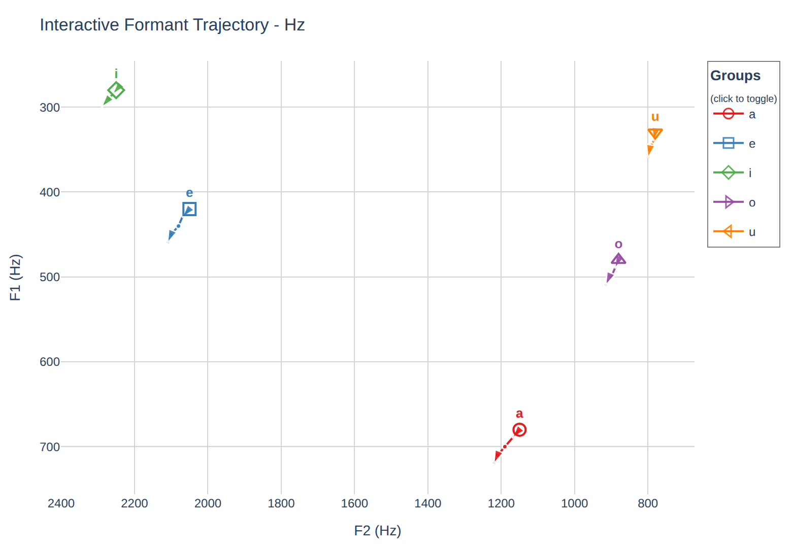
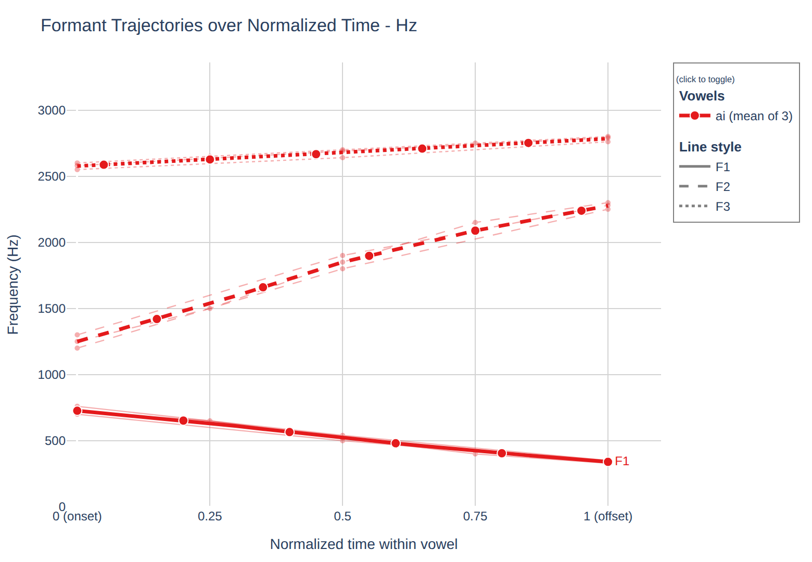
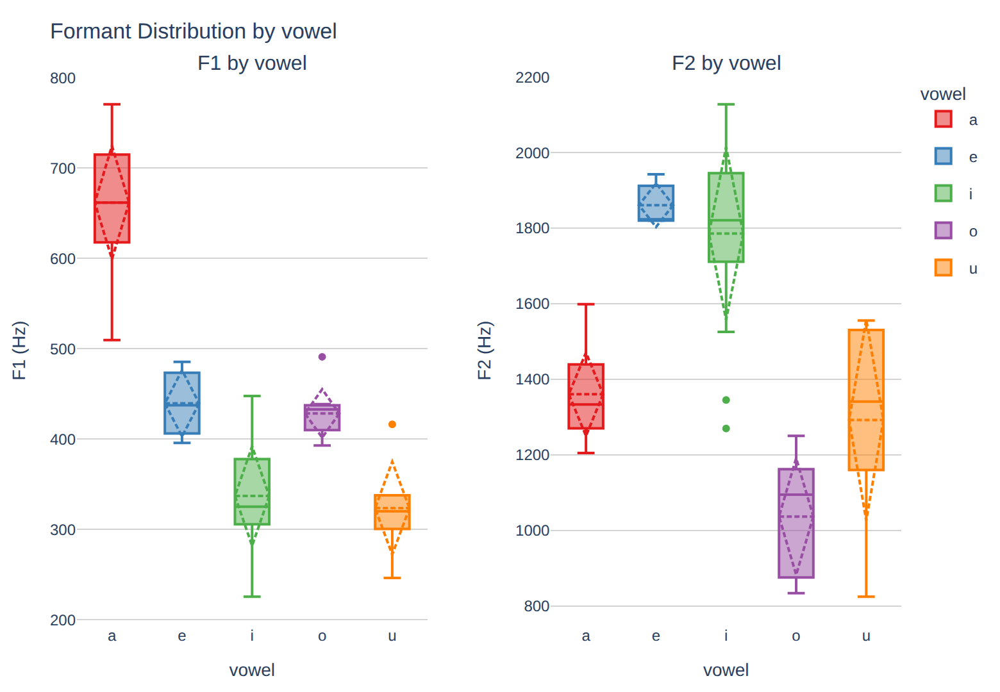
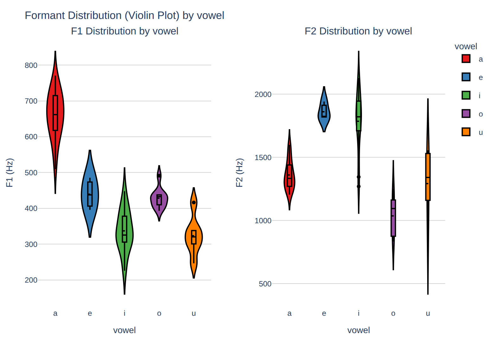
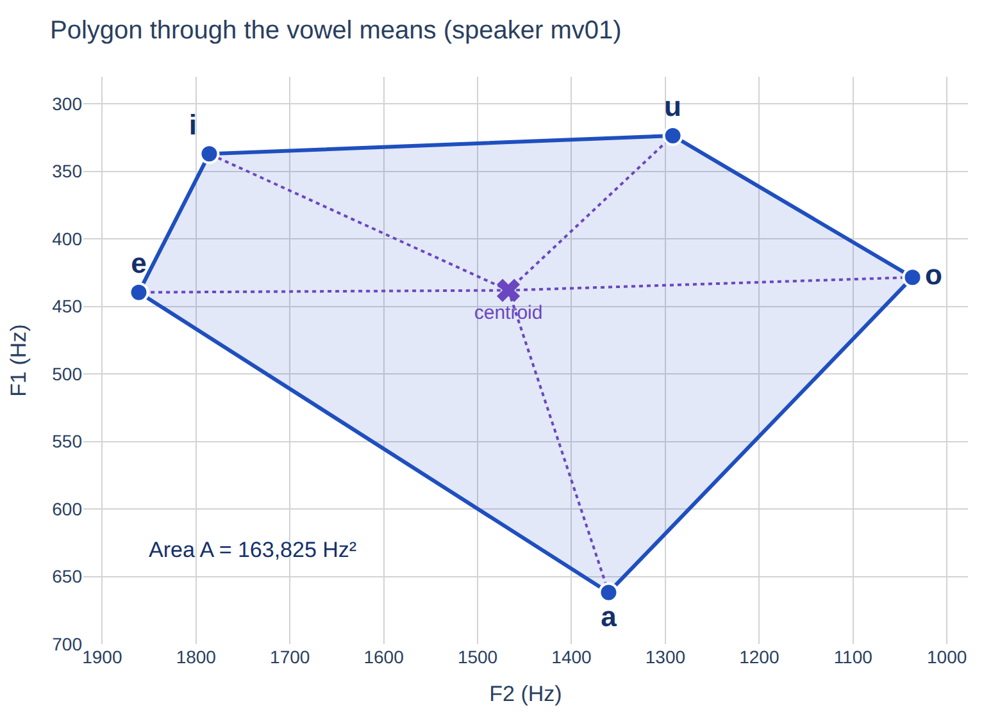

<!--
title: Vowel Space Visualizer
footer: Vowel Space Visualizer · vowelspace.tyoon.net
logo: img/logo.png
output: vowelspace_en.html
-->

<!-- layout: title -->
# Vowel Space Visualizer
## From recordings to vowel space plots, all in the browser
November 2026 · https://vowelspace.tyoon.net

::: presenter
**Presenter · Tae-Jin Yoon**

Dean, College of Creative Convergence · Professor of English Language and Literature, Sungshin Women's University

Homepage [https://tyoon.net](https://tyoon.net)
:::

::: notes
Vowel Space Visualizer is a web tool that measures vowel formants and draws them as vowel space plots. Today we briefly review what a vowel space is, then go through how to use the tool, the four plots, the frequency scales, how formants are extracted, and the statistical analyses.
:::

---
# Today's outline

::: cards
### 1 · Vowel space
Why vowels are plotted by F1 and F2, and what this tool does

### 2 · Using the tool
Logging in, input data, keeping and deleting uploaded files

### 3 · Four plots
Static vowel space, ellipses, group comparison, two kinds of trajectory

### 4 · Frequency scales
Hz and the auditory scales Bark, ERB and Mel

### 5 · Formant extraction
The four steps and the formant ceiling

### 6 · Statistics
Descriptives, MANOVA, pairwise tests, PCA, LDA
:::

---
<!-- layout: section -->
# 1 · Vowel space
## Two formants are enough to draw a vowel

---
<!-- layout: split | image: img/ellipse_hz.png | caption: Vowels a, e, i, o, u of one male speaker (extracted from the test recordings) -->
# A vowel space is a map of F1 and F2

- **Formants** are the resonance frequencies of the vocal tract
- **F1** reflects tongue height: high vowels have a low F1
- **F2** reflects tongue backness: front vowels have a high F2
- With both axes **reversed**, the plot resembles tongue position in the mouth

::: note
High vowels are at the top and front vowels on the left. /i/ sits top left, /a/ at the bottom.
:::

::: notes
The figure shows values actually extracted from the test recordings that come with the tool. Start by pointing out that the axes run the opposite way from an ordinary graph.
:::

---
# One tool takes you from recording to plot

::: flow
- 🔐 Log in
- 📤 Upload files
- 🎚️ Extract formants
- 📊 Plot
- 📈 Statistics · CSV
:::

- Upload **WAV + TextGrid** files: no Praat script is needed
- Values you have already measured (**CSV · XLSX**) can be plotted as they are
- Plots can be **zoomed, filtered and saved as PNG**
- Nothing to install: you only need a web browser

::: notes
Measurement runs on the server with the Praat engine (through Parselmouth), and the plots are drawn with Plotly.
:::

---
<!-- layout: section -->
# 2 · Using the tool
## Log in, upload, plot

---
<!-- layout: split | image: img/ui_login.png | caption: Login page (vowelspace.tyoon.net/login) -->
# Create an account and log in

1. On **Sign up**, enter a username, an email address and a password (8 characters or more)
2. When logging in, answer a simple **addition question**
3. When you are done, press **Log out** at the top right

- Every page and function requires a login
- Uploaded files are kept **separately for each account**

---
<!-- layout: split | image: img/ui_main.png | caption: Main page after logging in -->
# Choose the settings and upload files

- **Visualization Type**: four kinds of plot
- **Formant Scale**: Hz, Bark, ERB, Mel
- **Formant Ceiling**: used only for audio files
- **Compare Groups**: the basis for comparing groups
- **Choose Files**, then **Visualize**

::: note
With the default settings you get a plot just by uploading files.
:::

---
# There are two kinds of input

::: cols
### Tables of measurements
- **CSV · TXT · XLSX**
- Required columns: `vowel`, `F1`, `F2`
- Optional columns: `speaker`, `native_language`, `time`, `F3`
- Different column names are **recognised automatically**
+++
### Audio files
- **WAV + TextGrid** (a pair with the same name)
- Example: `fv01_kor_s01.wav` ↔ `fv01_kor_s01.TextGrid`
- The first part of the file name is the **speaker**, the second the **language or group**
- The TextGrid needs an interval tier with vowel labels
:::

::: notes
Vowel labels may be in ARPABET, IPA or romanised form. A word tier is never used as the vowel tier.
:::

---
# Uploaded files accumulate and are plotted together

- Uploaded files stay on the server **until you delete them**
- New files are **added** to the ones already there (same name: replaced)
- **All files** on the server are drawn in one plot
- To change only the settings, press **Visualize** again without files
- **✕** removes one file; **Delete all uploaded files** removes everything
- Files left unused for **7 days** are deleted automatically

::: note
Example: upload the files of Korean speakers, then add those of non-Korean speakers, and the two groups are drawn in contrasting colours and shading.
:::

::: notes
Each upload is one set, and with two or more sets the static and ellipse plots turn into a comparison of the sets. Each group has its own colour, marker fill and line style and its vowel space is shaded; vowels are told apart by marker shape and vowel symbol. A set can be named when it is uploaded, and under Compare Groups the basis of comparison can be changed to the letters of the speaker ID (fv, mv), the speaker or the language, or switched off. Without a comparison, groups are told apart by the first part (speaker) and second part (language or group) of the file name for audio, and by the speaker and native_language columns for tables. A table with neither column uses its file name as the group name. A WAV and its TextGrid form a pair and are deleted together. Recordings cannot be seen by other users; ask users to delete them when they have finished. One user can keep up to 500 MB in total.
:::

---
<!-- layout: section -->
# 3 · Four plots
## Four ways of looking at the same data

---
<!-- layout: image | image: img/static_hz.png | caption: Static vowel space: 2 speakers, 12 vowels, 106 tokens (extracted from the 5 test recordings) -->
# Vowels differ in both colour and marker shape

::: notes
Each vowel has a fixed colour and marker shape, so vowels can still be told apart by shape when there are many and the colours look alike. Speakers differ in marker fill. Here the filled markers are the female speaker and the open markers the male speaker. Clicking a legend entry hides that vowel; double-clicking shows that vowel alone.
:::

---
<!-- layout: split | image: img/ellipse_hz.png | caption: Vowel Space with Ellipses | wide: 1 -->
# Ellipses show the range of each vowel

- Each ellipse reaches **1 standard deviation** from the mean
- The **vowel symbol** is printed at the centre of the ellipse
- **Overlapping** ellipses mean two vowels are acoustically close
- A **large** ellipse means the vowel varies a lot between tokens

::: note
A 1 SD ellipse holds about 39% of the tokens. Many points outside the ellipse are normal.
:::

::: notes
The centre of an ellipse is the mean of the vowel's tokens; its orientation and length come from how F1 and F2 vary together (the covariance). It reaches one standard deviation along the long axis and along the short axis. The size of the ellipses differs between studies: 1 standard deviation (about 39%), 2 standard deviations (about 86%) and 95% (2.45 standard deviations) are all in use, so always check what the ellipses in a figure stand for. For this speaker the ellipse of /u/ stretches along F2 and touches that of /i/. No ellipse is drawn for a vowel with fewer than three tokens. With several speakers or language groups, the groups differ in line style (solid, dashed, dotted).
:::

---
<!-- layout: split | image: img/compare_static.png | caption: Female speaker (blue, filled markers, solid line) and male speaker (orange, open markers, dashed line); test recordings | wide: 1 -->
# Groups are contrasted by colour and shading

- Each group has its own **colour, marker fill and line style**
- The **shaded polygon** is the vowel space of the group
- Read the vowel from the **marker shape** and the **symbol** at the mean
- Click a group in the legend to hide it

::: note
Adding files later produces this plot automatically. Change the basis under **Compare Groups**.
:::

::: notes
Each upload is one set, and with two or more sets the static and ellipse plots turn into this comparison plot. A name given to a set when it is uploaded appears in the legend. Under Compare Groups the basis can be changed to the letters of the speaker ID (fv01 and fv02 become fv, mv01 becomes mv), the speaker or the language, or switched off. The large markers are the vowel means and the small ones the individual tokens. Speakers within a group are pooled. In this figure the female speaker has only six tokens, so only three vowels appear. Even so, it is clear at a glance that her vowel space is shifted to the lower left, that is, towards higher F1 and F2: her vocal tract is shorter, so all formants are higher. In the ellipse plot a 1 SD ellipse is drawn for every vowel as well. The comparison does not apply to the trajectory plots.
:::

---
# Trajectory plots show movement within a vowel

::: cols
### Trajectory in the F1–F2 plane

- The open marker is the **start**, the arrowhead the **end**
+++
### Trajectory over normalised time

- Time is scaled to **0–1** so tokens can be overlaid
- The bold line is the **mean**
:::

::: notes
Both figures use example data for illustration. Trajectory plots need a table with several time points per token. Values extracted from audio files have one point per vowel, so they do not suit these plots. The figure on the right is the diphthong /ai/: F1 falls and F2 rises.
:::

---
<!-- layout: section -->
# 4 · Frequency scales
## The ear does not hear in Hz

---
<!-- layout: split | image: img/scales_en.png | caption: The three auditory scales are steep at low frequencies and flatter at high frequencies | wide: 1 -->
# The same 100 Hz does not sound the same

- **Hz** counts vibrations per second: a **physical** unit
- The ear is more sensitive to differences at **low frequencies**
- 300 → 400 Hz is a difference of **0.99 Bark**
- 2300 → 2400 Hz is a difference of **0.28 Bark**

::: note
An auditory scale redraws the frequency axis so that equal steps sound equally far apart.
:::

::: notes
In a vowel space drawn in Hz, distances along F2 look larger than they sound, because F1 spans a few hundred Hz while F2 spans roughly 1000 to 2500 Hz. On an auditory scale, differences in F1 become relatively larger and differences in F2 smaller. The figure sets the range 0 to 4000 Hz to 100% and shows the position of each frequency on each scale.
:::

---
<!-- footnote: Formulas used by the tool: Traunmüller (1990), Glasberg & Moore (1990), O'Shaughnessy (1987). $f$ is the frequency in Hz -->
# The tool supports three auditory scales

| Scale | Based on | Formula |
|---|---|---|
| **Bark** | **Critical bands**: the frequency range the ear hears as one unit | $z = \dfrac{26.81\,f}{1960 + f} - 0.53$ |
| **ERB** | **Auditory filter width**: a more precise measurement of critical bands | $E = 21.4\,\log_{10}(1 + 0.00437\,f)$ |
| **Mel** | **Pitch perception**: judgements such as "twice as high" | $m = 2595\,\log_{10}\!\left(1 + \dfrac{f}{700}\right)$ |

- All three **stretch** low frequencies and **compress** high frequencies
- The units differ, but the curves have a similar shape

::: notes
A critical band is the range of frequencies that excite the same region of the basilar membrane in the cochlea. One Bark corresponds to one critical band. ERB follows the same idea but is based on more precise experiments, and Mel comes from experiments in which listeners judged pitch. The Mel scale is set so that 1000 Hz equals 1000 Mel.
:::

---
# The same frequency on each scale

| Hz | Bark | ERB | Mel |
|---|---|---|---|
| 500 | 4.92 | 10.77 | 607 |
| 1000 | 8.53 | 15.62 | 1000 |
| 2000 | 13.01 | 21.16 | 1521 |
| 3000 | 15.69 | 24.60 | 1876 |

- 500 → 1000 Hz is **3.6 Bark**; 2000 → 3000 Hz is **2.7 Bark**
- The frequency difference is twice as large, yet the auditory distance is **smaller**

::: notes
The values in the table were computed with the tool's own conversion functions. It works well to let students subtract the Bark values themselves: 8.53 minus 4.92 is 3.61, and 15.69 minus 13.01 is 2.68.
:::

---
<!-- layout: split | image: img/ellipse_bark.png | caption: The same data as an ellipse plot on the Bark scale | wide: 1 -->
# Choose the scale that fits your purpose

- **Hz**: to report the measurements as they are
- **Bark · ERB**: to compare **perceptual distances** between vowels
- **Mel**: to match speech technology data
- The chosen scale applies to **both plots and statistics**

::: note
The values in the downloaded CSV are always in Hz, whatever scale is selected.
:::

::: notes
Compared with the earlier Hz figure, the F1 direction (vertical) becomes relatively wider and the F2 direction (horizontal) narrower. Mel is the scale underlying MFCCs, which are used in speech recognition.
:::

---
<!-- layout: section -->
# 5 · Formant extraction
## Measurements are fitted to each speaker

---
<!-- footnote: Measurement: Praat To Formant (burg), 5 formants, 25 ms window, 10 ms time step. Boersma & Weenink, [Praat manual](https://www.fon.hum.uva.nl/praat/manual/Sound__To_Formant__burg____.html) -->
# Formants are extracted in four steps

::: flow
- 🔎 Find vowel intervals
- 🎚️ Set the ceiling
- 📏 Measure tokens
- 🧹 Clean up · export
:::

- The audio is resampled to **16 kHz** and only vowel intervals are taken from the TextGrid
- The most stable **formant ceiling** is found for each speaker
- Five points in the **middle 25%** of the vowel are measured and averaged
- Values beyond **±3 standard deviations** per vowel are removed; the rest can be downloaded as CSV

::: notes
The edges of a vowel are influenced by the neighbouring consonants, so only the middle part is used. Averaging five points reduces the effect of a single frame where the tracker jumps.
:::

---
<!-- footnote: Conventional values: Boersma & Weenink, [Praat manual](https://www.fon.hum.uva.nl/praat/manual/Sound__To_Formant__burg____.html) -->
# The formant ceiling is the upper limit of the search

- Praat looks for **5 formants** between **0 Hz and the ceiling**
- The **shorter** the vocal tract, the higher the formants, and the higher the ceiling must be
- The convention is **5000 Hz for men** and **5500 Hz for women**
- But vocal tract length differs between speakers of the same sex

::: note
The ceiling is an assumption about where this speaker's fifth formant lies.
:::

::: notes
Formant analysis (LPC) assumes a fixed number of resonances within a fixed frequency range and then finds where they are. If the range does not fit the speaker, the result goes wrong. In Praat this setting is called Maximum formant. Speakers with a short vocal tract, such as children, need a much higher value.
:::

---
<!-- footnote: Vowel means of speaker mv01 (male). The same recordings re-measured with this tool, changing only the ceiling -->
# A wrong ceiling changes the measurements

| Ceiling | /i/ F1 | /i/ F2 | /a/ F1 | /a/ F2 |
|---|---|---|---|---|
| 4000 Hz (too low) | 317 | **1546** | 649 | 1292 |
| **5060 Hz (chosen automatically)** | 337 | 1786 | 662 | 1360 |
| 6500 Hz (too high) | **1241** | **2446** | **1041** | 1951 |

- **Too low**: two formants **merge** into one. F2 of /i/ dropped by 240 Hz
- **Too high**: one formant **splits** into two. F1 of /i/ became 1241 Hz

::: notes
Stress that these are the same recordings and the same vowels, and one setting changes the values this much. An F1 of 1241 Hz is impossible for a high vowel like /i/. With a high ceiling, spurious formants appear and shift the numbering, or the result varies wildly from token to token. All values are in Hz.
:::

---
<!-- layout: split | image: img/sweep_en.png | caption: Speaker mv01: 4000–4300 Hz rejected as implausible; the score is lowest at 5060 Hz | wide: 1 | footnote: Criterion: Feinberg (2019) [OSF PDWCB](https://doi.org/10.17605/OSF.IO/PDWCB) · Rejection rules: Barreda (2021) Fast Track -->
# The tool searches for the most stable ceiling

1. Try every ceiling from **4000 to 8000 Hz** in 100 Hz steps
2. Measure F1–F4 of every vowel at each setting
3. Score **how much F3 and F4 vary**
4. **Reject** implausible results
5. Search again around the best value in **20 Hz** steps

::: notes
F3 and F4 change little from vowel to vowel. With the right ceiling they should therefore be nearly constant across all tokens, and with a wrong one they vary from token to token. That variation (variance) is the score. Results are rejected when, for example, the median F1 exceeds 1200 Hz or F1 and F2 have merged in many tokens. The large peak near 6000 Hz in the figure corresponds to the "too high" row of the table on the previous slide.
:::

---
<!-- footnote: Actual results for the 5 test recordings · Escudero, Boersma, Rauber & Bion (2009) JASA 126(3) -->
# Results are reported for each speaker

| Speaker | Tokens | Chosen ceiling |
|---|---|---|
| mv01 (male, 4 files) | 97 | **5060 Hz** |
| fv01 (female, 1 file) | 9 | **6940 Hz** |

- Files whose names start with the same part belong to the **same speaker**
- The criterion can be changed to **within-vowel F1–F2 stability**
- A separate ceiling per vowel is possible (5 tokens or more)
- Fixed values can also be chosen: **5500 · 5000 · custom**

::: note
With few tokens the result is unstable. The female speaker's value comes from only 9 tokens.
:::

::: notes
The automatic method does not guess the speaker's sex; it searches directly in the speaker's data. The 6940 Hz for the female speaker comes from only nine tokens and should not be trusted as it stands. Tell students to prepare plenty of vowel tokens per speaker. Escudero and colleagues reported that the best ceiling differs between vowels even within one speaker.
:::

---
<!-- layout: section -->
# 6 · Statistics
## Confirming with numbers what the plots suggest

---
# The statistics answer six questions

::: cards
### Descriptive statistics
What is the value of each vowel, and how much does it vary?

### MANOVA
Do the formants really differ between vowels?

### Pairwise tests
Which two vowels differ, and by how much?

### PCA
In which direction do the data vary most?

### LDA
Can the vowel be predicted from the formants alone?

### Vowel space size
How large is the vowel space?
:::

::: note
All examples below are real results for the 65 tokens of the vowels a, e, i, o, u of the male speaker mv01.
:::

::: notes
After drawing a plot, the statistical analysis button analyses the same data. The selected scale (Bark and so on) is used for the statistics too. Mention in advance that the number of tokens differs between vowels in the example data, and that /e/ has only three.
:::

---
# Descriptive statistics: means and standard deviations

| Vowel | Tokens | F1 mean (SD) | F2 mean (SD) |
|---|---|---|---|
| a | 31 | 662 (64) | 1360 (112) |
| e | 3 | 440 (45) | 1861 (71) |
| i | 16 | 337 (57) | 1786 (236) |
| o | 9 | 428 (28) | 1037 (164) |
| u | 6 | 324 (56) | 1292 (291) |

- The **mean** is the typical position of a vowel; the **standard deviation** is its spread
- /u/ has the largest F2 standard deviation: that is why its ellipse was so wide

::: notes
The unit is Hz. The means in this table are the centres of the ellipses, and the standard deviations determine their size. Minimum and maximum values are reported as well. Also point out that the mean of a vowel with few tokens is less reliable.
:::

---
# Box plots and violin plots show the distribution

::: cols
### Box plot

- The box is the **middle 50%**; the line inside is the **median**
- Points lying apart are **outliers**
+++
### Violin plot

- Where the shape is wide, **many** values lie
- Two bulges may mean that two groups are mixed
:::

::: notes
The whiskers of a box plot reach the most distant value within 1.5 times the length of the box. A violin plot adds the shape of the distribution to a box plot. The density plot shows the same information as a curve.
:::

---
<!-- layout: split | image: img/meancmp.png | caption: Mean comparison plot: n above each bar is the number of tokens | wide: 1 -->
# Error bars show how uncertain the mean is

- The height of a bar is the **mean**
- The error bar is the **standard error**
- The **more** tokens, the shorter the error bar

::: math
\mathrm{SE} = \frac{s}{\sqrt{n}}
:::

- $s$ is the standard deviation and $n$ the number of tokens

::: note
The standard deviation is the spread of the data; the standard error is how far the mean can be trusted.
:::

::: notes
Students often confuse the standard deviation with the standard error. /a/ has 31 tokens and a short error bar; /u/ has 6 and a long one.
:::

---
# MANOVA: do the vowels really differ?
## Multivariate Analysis of Variance

- **Question**: do the vowel means differ when F1 and F2 are considered **together**?
- **Wilks' Λ = 0.039**: the closer to 0, the better the vowels are separated (1 means no difference)
- Each formant is then checked **separately** with an analysis of variance (ANOVA)

| Formant | F value | p value | Result |
|---|---|---|---|
| F1 | 112.8 | below 0.001 | significant `***` |
| F2 | 34.1 | below 0.001 | significant `***` |

- **F value**: differences between vowels ÷ scatter within vowels
- **p value**: the probability of such a result if there were no difference

::: notes
An analysis of variance (ANOVA) compares one dependent variable between groups; a multivariate analysis of variance (MANOVA) compares several dependent variables at once. A vowel is defined by two values, F1 and F2, so MANOVA, which looks at both together, asks the right question. Wilks' lambda is the share of the total scatter that lies within the vowels, so a smaller value means larger differences between vowels. The tool reports the value of Wilks' lambda, and it reports significance (p values and stars) for the one-way ANOVA of F1 and of F2. Three stars mean below 0.001, two below 0.01, one below 0.05, and ns means not significant. MANOVA only says that at least one vowel differs; which vowels differ is answered by the pairwise tests on the next slide.
:::

---
<!-- layout: split | image: img/pairwise.png | caption: Pairwise mean differences: stars show the significance level, ns means not significant | wide: 1 -->
# Pairwise tests: which two vowels differ?

- Vowels are compared two at a time with a **t-test**
- **Cohen's d** is the size of the difference: 0.2 small, 0.5 medium, 0.8 large
- /i/ vs /a/: F1 differs by 325 Hz, **d = 5.3**
- /i/ vs /u/: F1 differs by 13 Hz, **not significant**
- /i/ vs /u/: F2 differs by 494 Hz, **d = 2.0**

::: note
/i/ and /u/ have the same tongue height (F1) and differ only in backness (F2).
:::

::: notes
Cohen's d is the mean difference divided by the standard deviation, so it has no unit. The p value answers "is there a difference?" and d answers "how large is it?". Note that five vowels give ten comparisons, and the more comparisons are made, the more likely it is that one turns out significant by chance. The tool does not correct for multiple comparisons, so a correction should be considered when the results are reported.
:::

---
<!-- layout: split | image: img/pca.png | caption: PCA plot: the axis titles give the share of variance explained | wide: 1 -->
# PCA: finding the direction of greatest variation

- F1 and F2 are **standardised** to remove the difference in units
- The direction in which the data spread most is **PC1**
- The direction at right angles to PC1 is **PC2**
- In these data: PC1 **66.9%**, PC2 **33.1%**

::: note
PCA does not use the vowel labels. It looks only at the shape of the data.
:::

::: notes
Principal component analysis is normally used to reduce many variables to a few axes. Here there are only two variables, F1 and F2, so it is closer to rotating the axes than to reducing dimensions. A PC1 of 66.9% means that two thirds of the total variation lies along one direction. In these data PC1 is the direction in which F1 increases while F2 decreases.
:::

---
<!-- layout: split | image: img/lda.png | caption: LDA plot: the data redrawn on the axes that separate the vowels best | wide: 1 -->
# LDA: predicting the vowel from the formants

- The vowel labels are **given**, and the axes that separate them best are found
- These axes are used to **predict** the vowel of each token
- In these data: 56 of 65 correct, accuracy **86.2%**
- Most errors were between **/i/ and /u/**

::: note
PCA finds the direction of spread; LDA finds the direction of separation.
:::

::: notes
The accuracy of a linear discriminant analysis can serve as a measure of how well two vowels are distinguished acoustically. For example, if a learner does not distinguish two vowels well, the accuracy is low. Note that the tool trains and evaluates on the same data, so the accuracy is higher than it would be for new data.
:::

---
# Vowel space size: how much of the space is used?

- The **area** of the outer polygon through the vowel **means** is computed
- The **centroid** is the middle of the vowel means
- The **dispersion** is the mean distance from the centroid to each vowel
- A **large** area means the vowels are produced far apart from each other

| Measure | Value for speaker mv01 |
|---|---|
| Area | 163,825 Hz² |
| Centroid | F1 438 Hz, F2 1467 Hz |
| Dispersion | 323 Hz |

::: note
The area is meaningful when comparing speakers or speaking styles. The value changes with the scale.
:::

::: notes
A large vowel space means that the vowels are produced far apart from each other. It is known to expand in clear speech and shrink in fast speech. If there is a speaker or language group column, values for each group are reported too. A single value cannot be called large or small on its own; it needs something to compare with. The next slide shows the calculation with a figure.
:::

---
# How the vowel space size is calculated

::: cols
- **Area A** of the polygon through the vowel means

::: math
A = \frac{1}{2}\left| \sum_{i=1}^{n} \left( x_i\,y_{i+1} - x_{i+1}\,y_i \right) \right|
:::

- **Centroid c**: the mean of the vowel means

::: math
c = \left( \frac{1}{n}\sum_{i=1}^{n} \mathrm{F1}_i,\ \frac{1}{n}\sum_{i=1}^{n} \mathrm{F2}_i \right)
:::

- **Dispersion D**: the mean distance from the centroid

::: math
D = \frac{1}{n}\sum_{i=1}^{n} \sqrt{(\mathrm{F1}_i - c_1)^2 + (\mathrm{F2}_i - c_2)^2}
:::

- $x$ is F2, $y$ is F1; vertices taken in order
+++

| A | c | D |
|---|---|---|
| 163,825 Hz² | F1 438, F2 1467 Hz | 323 Hz |
:::

::: notes
The blue polygon in the figure is the vowel space, and its area is A. The area formula is known as the shoelace formula: going round the vertices in the order a, e, i, u, o, the coordinates are cross-multiplied, summed and halved. Students can compute it themselves from the table of vowel means on the descriptive statistics slide. The purple dotted lines are the distances from the centroid to each vowel. For this speaker they are 248 Hz for a, 394 for e, 334 for i, 431 for o and 209 for u, with a mean of 323 Hz. When a vowel lies inside the others, only the outermost points are connected (the convex hull). If there is a speaker or language group column, values for each group are reported too.
:::

---
# Summary

- Plotting vowels by **F1 and F2** shows the position of the tongue
- Upload **WAV + TextGrid** files or a **table of measurements**
- Vowels differ in **colour and shape**; speakers in **fill and line style**
- **Bark · ERB · Mel** are scales fitted to the distances the ear hears
- The formant ceiling is set **automatically for each speaker**
- Statistics look at both **whether there is a difference** (p) and **how large it is** (d)

::: note
Address: [https://vowelspace.tyoon.net](https://vowelspace.tyoon.net) · Source: [github.com/exphon/vowelspace](https://github.com/exphon/vowelspace)
:::

---
# References

- Barreda, S. (2021). Fast Track: fast (nearly) automatic formant-tracking using Praat. *Linguistics Vanguard*, 7(1).
- Boersma, P., & Weenink, D. Praat manual, [Sound: To Formant (burg)...](https://www.fon.hum.uva.nl/praat/manual/Sound__To_Formant__burg____.html)
- Escudero, P., Boersma, P., Rauber, A. S., & Bion, R. A. H. (2009). A cross-dialect acoustic description of vowels: Brazilian and European Portuguese. *JASA*, 126(3), 1379–1393.
- Feinberg, D. R. (2019). Automated Formant Ceiling Settings. OSF Registries. [doi:10.17605/OSF.IO/PDWCB](https://doi.org/10.17605/OSF.IO/PDWCB)
- Glasberg, B. R., & Moore, B. C. J. (1990). Derivation of auditory filter shapes from notched-noise data. *Hearing Research*, 47, 103–138.
- O'Shaughnessy, D. (1987). *Speech Communication: Human and Machine*. Addison-Wesley.
- Traunmüller, H. (1990). Analytical expressions for the tonotopic sensory scale. *JASA*, 88(1), 97–100.
